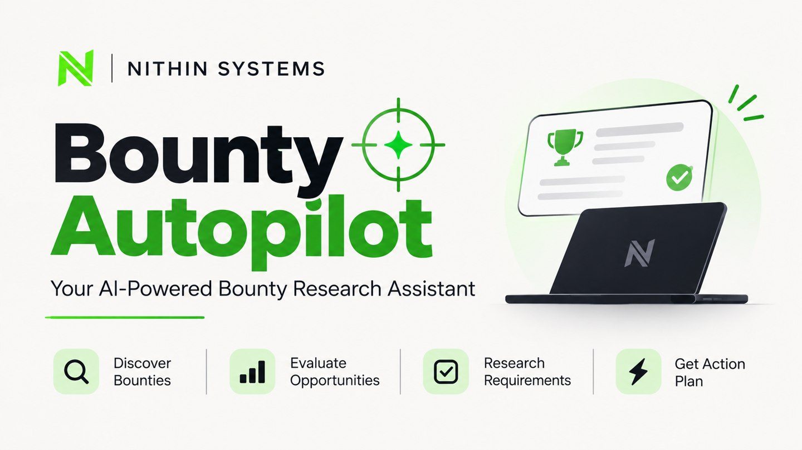

# NithinSystems — Bounty Autopilot Community Edition

> **Release-candidate draft — NOT READY FOR PUBLIC RELEASE**

This archive packages the part of Bounty Autopilot that could be verified from the accessible project source: the **trusted GitHub evidence collector**. It is not the complete bounty-discovery product.

## What is actually included

- A manually triggered GitHub Actions workflow for verifying a proposed patch against an immutable baseline commit.
- A fixed Python `unittest` test command.
- Isolated Docker execution for the baseline and patched revisions.
- Evidence output containing commit references, exit codes, test counts, SHA-256 hashes, and the pinned runner image.
- A validator that rejects empty suites, a passing baseline, a failing patched run, mismatched test counts, invalid hashes, and any claim that the collector approved submission.

## What is deliberately not included

- Production-ready n8n discovery workflows. Experimental inactive GitHub and Algora-via-GitHub examples are in [experimental/discovery](experimental/discovery/README.md).
- The live Mission Control dashboard or its backend.
- A production-ready multi-platform discovery system.
- AI opportunity scoring or an LLM configuration.
- Telegram notifications.
- A solution-building agent.
- Automatic claims, comments, contact, pushes, pull requests, or submissions.

Recovered development examples are provided separately; they are not an installable release. See [discovery status](experimental/discovery/README.md).

## Quick start — evidence collector only

1. Read [`docs/INSTALLATION.md`](docs/INSTALLATION.md).
2. Review [`docs/SAFETY_PRIVACY.md`](docs/SAFETY_PRIVACY.md).
3. Install Git, Python 3, Bash, and Docker.
4. Run the local checks:

   ```bash
   python -m unittest discover -s tests -v
   bash -n scripts/collect-evidence.sh
   ```

5. Place this package in a GitHub repository only after owner review.
6. Run **Actions → Verify bounty patch → Run workflow** with a public GitHub repository URL, two full 40-character commit SHAs, and a short bounty identifier.

The workflow does not submit a bounty solution. It produces an evidence artifact for a human to inspect.

## Requirements and limits

- Target repository must be a **public GitHub HTTPS repository**.
- The collector currently supports Python projects whose tests run with `python -m unittest discover` and do not need to download dependencies during the test.
- The baseline revision must demonstrate a failing test; the patched revision must pass; test counts must match.
- Docker must be available to the runner.
- The worker itself does not call an AI model and does not send Telegram messages.

## Cost notes

- The included Python scripts and workflow file do not require a paid AI API.
- GitHub Actions usage is subject to the current GitHub plan, runner and usage quotas.
- Docker Engine is available without a per-test AI charge; hosting, hardware, electricity and any Docker Desktop licensing obligations may still matter.
- The complete n8n discovery system, any LLM calls, and Telegram alerts are outside this package. Their costs cannot be represented as zero until the actual workflows and chosen providers are restored and checked.

## Release status

Before a public launch, recover and review the original n8n workflow export, remove or disable any automatic-contact path, run a clean n8n import test, decide the project license, and complete the checklist in [`docs/RELEASE_CHECKLIST.md`](docs/RELEASE_CHECKLIST.md).

**This is an incomplete preview. Original services were not modified, and credentials are not included in the recovered workflow copies.**
